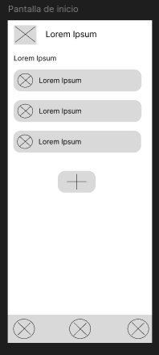
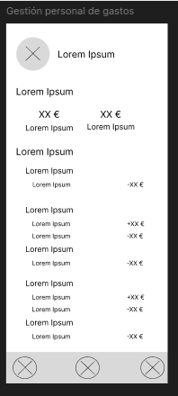
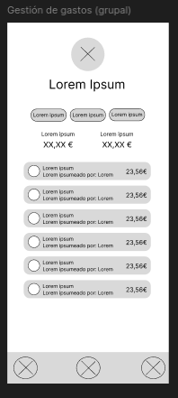
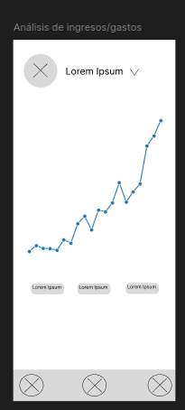
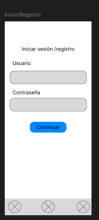
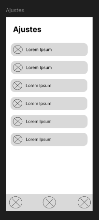

# Mockups de PocketSplit

Estos seis esquemas representan las vistas principales previstas. Los textos
«Lorem Ipsum», iconos genéricos, importes y datos de ejemplo son marcadores:
no definen por sí solos el contenido final ni el comportamiento de la app.

## 1. Pantalla de inicio

Muestra una cabecera con imagen y texto, un subtítulo y tres elementos de lista
con icono y texto. Debajo aparece un botón con el símbolo «+». En la parte
inferior hay una barra con tres iconos.

La finalidad concreta de cada elemento y del botón queda por definir. La
navegación inferior se acordó después: Inicio, Estadísticas y Ajustes.

## 2. Gestión personal de gastos

Presenta una cabecera con icono y título, dos valores monetarios destacados y
una lista de movimientos con textos e importes positivos o negativos. Incluye
la barra inferior de tres iconos.

Los nombres de los valores destacados, las categorías y las acciones sobre los
movimientos no se especifican en el esquema.

## 3. Gestión de gastos grupales

Incluye una cabecera centrada con icono y título, tres etiquetas, dos valores
monetarios y una lista de gastos con icono, textos y un importe. También muestra
la barra inferior.

Las etiquetas, la información de participantes y las reglas de reparto quedan
pendientes de definición; el esquema no demuestra que esas funciones existan.

## 4. Análisis de ingresos y gastos

Contiene una cabecera con icono, texto y un indicador desplegable, un gráfico
de líneas y tres etiquetas o controles debajo. Al pie aparece la barra inferior.

No se indican los ejes, el periodo representado, las unidades ni la función de
los tres controles; se decidirán al diseñar la vista.

## 5. Inicio de sesión y registro

Muestra un título de inicio de sesión o registro, campos de usuario y contraseña,
un botón «Continuar» y la barra inferior.

El esquema no precisa la separación entre acceso y registro, las validaciones ni
el mecanismo de autenticación.

## 6. Ajustes

Presenta el título «Ajustes» y seis elementos de lista con iconos y textos de
marcador, además de la barra inferior.

Las opciones concretas y su comportamiento quedan por definir.

## Ajustes y navegación inferior

**Estado:** implementadas como vistas provisionales y navegación. Esta fase no
implementa autenticación, preferencias, persistencia, estadísticas reales ni
cierre de sesión.

### Decisiones acordadas

- Mostrar una barra inferior con tres destinos: **Inicio**, **Estadísticas**
  y **Ajustes**. No mostrarla en inicio de sesión/registro; sí en las demás
  pantallas, incluida la gestión de gastos personales.
- Inicio abre la pantalla existente. Ajustes abre la nueva pantalla provisional.
  Estadísticas abre una pantalla provisional identificada como tal, sin datos
  financieros reales.
- Ajustes reproduce la estructura del mockup: título y seis filas visuales con
  iconos o marcadores. Por ahora no se asignan nombres ni funciones a las filas;
  no son controles interactivos.
- La intención a futuro es mostrar el acceso solo cuando corresponda, por
  ejemplo al iniciar sesión o después de cerrar sesión. La app actual no
  implementa sesiones: decidir y construir esa lógica queda fuera de esta fase.

### Implementación y comprobaciones

- La barra compartida está en el `Scaffold` y utiliza la ruta actual para
  mostrar el destino seleccionado. En Finanzas se selecciona Inicio; al
  pulsarlo se vuelve a Inicio.
- Desde Finanzas, Estadísticas o Ajustes, Atrás vuelve a Inicio. Las filas de
  Ajustes son decorativas y Estadísticas indica que está pendiente.
- Se compiló la APK de depuración y se comprobaron en un emulador los destinos,
  Atrás, las pulsaciones repetidas y la conservación de un movimiento ficticio
  durante la sesión. También se revisaron las etiquetas accesibles y el
  contenido con texto ampliado.
- Las pruebas unitarias existentes siguen sin compilar porque el módulo no
  declara JUnit. No se modificaron las dependencias.

## Relación con la implementación actual

En el código existen pantallas de acceso, inicio y finanzas personales. Las
pantallas de acceso e inicio contienen elementos de ejemplo, y la vista de
finanzas permite registrar movimientos en memoria. Esto no implica que esas
pantallas reproduzcan completamente los mockups. También existen las vistas
provisionales de Ajustes y Estadísticas descritas arriba. La gestión grupal y
la vista final de análisis siguen pendientes de definición e implementación.
